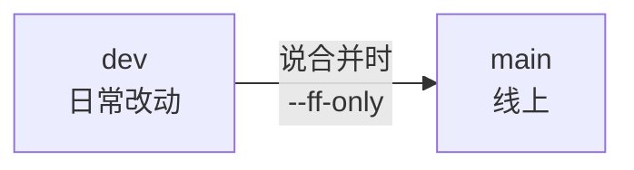

# 分支策略

> 本仓库管理的是技能定义源文件（纯文本），分支模型保持最简：**两条长期分支，改动直接提交在 `dev` 上**。
>
> 与 `sx-agent` 的完整分支模型（`docs/04_AI_WORKFLOW.md` §2.4）不同——那边有服务要部署，才有 dev / staging / master 三分支与 hotfix 流程；这里没有可部署的东西，只留两条。

---

## 一、两条分支

| 分支 | 含义 | 怎么用 |
|------|------|--------|
| `main` | **线上**：平台在跑的那一份技能 | 只在发布时从 `dev` 合入，**不直接改** |
| `dev` | **集成**：日常改动都在这里 | 所有修改直接提交到 `dev` |



---

## 二、日常改动：直接在 dev 上

```bash
git switch dev
# 改文件……
git add <改动的文件>
git commit
```

- **不建特性分支**：本仓库改动都是文本，一次改动一个提交就装得下，不需要为它开分支、再合回来
- **提交粒度**：一件事一个提交（如"某技能改走 show_content"），信息里说清改了什么、为什么

---

## 三、合并到 main：等明确指示

```bash
git switch main && git merge dev --ff-only
git push origin main
```

- **时机由人定**：技能在平台上验证通过、并明确说了"合并"，才动 `main`
- 一律 `--ff-only`，**不要 merge commit**（`--no-ff` 会让历史分叉，两个分支的差异越拉越大）
- 合并后 `main` 与 `dev` 指向同一个提交，继续在 `dev` 上改

---

## 四、远端

- 只有 `main` 与 `dev` 推远端：`git push origin dev` / `git push origin main`
- 没有特性分支，也就不存在"哪些分支不该推"的问题
- 远端分支列表 = 环境映射：`main` 是线上，`dev` 是集成

---

## 五、两条底线

1. **不要直接在 `main` 上提交** —— 它是线上指针，往上面提交就等于宣布发布
2. **不要改写已推送的历史**（`rebase` / `commit --amend` 之后强推 `dev`）—— 远端有自己的记录，改写后两边对不上；要撤销就往前加一个提交

---

## 六、一个容易踩的坑：git tag ≠ 平台技能版本

本仓库不强制打 tag，需要标记发布点时用 `v<主>.<次>`（如 `v1.1`），在合并到 `main` 之后、上传平台之前打。

> **两者是两套独立体系**：git tag 标记的是**仓库内容的状态**；技能包的 `version` 由平台在**每次上传时自动 +1**（同名上传不报冲突，落为新版本）。同一个 `v1.1` 下，某个技能包可能已经因为反复调试上传到平台侧的第 3 版——排查"改了但行为没变"时先看平台侧版本号，别拿 git tag 对。
