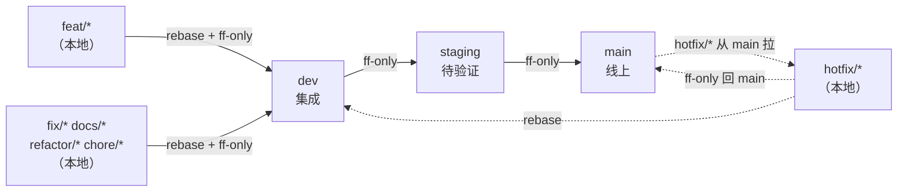

# 分支策略

> 本仓库（`sx-skills-online`）的分支模型与操作规范。
>
> **口径来源**：与 `sx-agent` 的 `docs/04_AI_WORKFLOW.md` §2.4 一致（线性历史、`--ff-only` 推进、特性分支本地保留），按内容仓库的特点做了裁剪——本仓库只有技能定义源文件，没有运行时，因此"发布"是**把技能包上传到平台**，不是部署服务。

---

## 一、三条核心原则

1. **线性历史，禁止 merge commit**：所有分支处在同一条线性时间线上，一律用 `git merge --ff-only` 推进，零 merge commit。
2. **特性分支只在本地**：`feat/*`、`fix/*`、`docs/*`、`refactor/*`、`chore/*` 开发完合入 `dev` 后保留在本地，**不推远端**。
3. **只有长期分支与远端同步**：远端只保留 `main` / `dev` / `staging` 三条长期分支，它们构成"远端分支列表 = 环境映射"的一一对应关系。

---

## 二、分支职责

| 分支 | 映射 | 操作方式 | 推远端 |
|------|------|---------|--------|
| `main` | **线上**：已发布、平台在跑的技能版本 | 仅 `--ff-only`，**不做开发，禁止直接提交** | ✅ 推 |
| `dev` | **集成**：下一次发布的内容 | 主动开发，所有特性分支在此合入 | ✅ 推 |
| `staging` | **待验证**：准备打包上传平台的技能 | 仅 `--ff-only`，**不做开发，禁止直接提交** | ✅ 推 |
| `feat/*` | 本地：新增技能 | 从 `dev` 拉出，rebase 后 `--ff-only` 合入 | ❌ 不推 |
| `fix/*` | 本地：修复技能缺陷（非线上紧急） | 同上 | ❌ 不推 |
| `docs/*` | 本地：文档与指南 | 同上 | ❌ 不推 |
| `refactor/*` | 本地：重构技能结构，**不变动技能行为** | 同上 | ❌ 不推 |
| `chore/*` | 本地：杂项（清理字段、调整打包等） | 同上 | ❌ 不推 |
| `hotfix/*` | 线上紧急修复 | 从 `main` 拉出，见 [§5.4](#54-线上紧急修复) | ❌ 不推 |

**命名**：`<前缀>/<kebab-case-描述>`，如 `feat/ljy-docx-export`、`docs/branch-strategy`。

**流转示意**：



---

## 三、远端同步规则

**远端只有三条长期分支**，其余分支不推：

| 分支 | 推远端 | 理由 |
|------|--------|------|
| `main` / `dev` / `staging` | ✅ | 它们是环境指针，远端需要与本地保持一致 |
| `feat/*`、`fix/*`、`docs/*`、`refactor/*`、`chore/*` | ❌ | 短命分支，推上去只制造噪音与待删分支 |
| `hotfix/*` | ❌ | 合完即弃，修复本身已随 `main` / `dev` 同步 |

**为什么不推特性分支**：远端的分支列表就是环境映射，多一条就多一处"这条对应什么环境"的误解成本。本地分支列表长一点没有代价——它不进任何人的视野。

**例外（临时推送）**：需要跨设备接力或请人评审某条特性分支时，可以临时推上去，**用完即删**：

```bash
git push -u origin feat/xxx          # 临时推送
git push origin --delete feat/xxx    # 用完删除远端分支（本地分支保留）
```

**本地特性分支合并后保留**，不删除——它是这次改动的完整记录，删除后只剩 `dev` 上的压缩历史。

---

## 四、当前状态

| 分支 | 本地 | 远端 | 说明 |
|------|------|------|------|
| `main` | ✅ | ✅ `origin/main` | 已建立，当前唯一长期分支 |
| `dev` | ❌ | ❌ | **待建立**，见下 |
| `staging` | ❌ | ❌ | **待建立**，需要内网验证环节时再建 |

**建立 `dev` 与 `staging`**（在 `main` 当前位置拉出并推送）：

```bash
git switch -c dev main && git push -u origin dev
git switch -c staging main && git push -u origin staging
git switch dev
```

> 在此之前，特性分支直接从 `main` 拉出、合回 `main`。建立 `dev` 后，`main` 只接受来自 `staging` 的 `--ff-only` 推进。

---

## 五、常用流程

### 5.1 新增 / 修改技能

```bash
git switch dev
git pull                                   # 若 dev 已推远端
git switch -c feat/ljy-docx-export dev     # 从 dev 拉出（不是从 staging）
# ... 开发、跑校验、验证 ...
git fetch origin && git rebase origin/dev  # 同步 dev 最新
git switch dev && git merge --ff-only feat/ljy-docx-export
# 分支保留在本地，不推远端
```

### 5.2 提测

```bash
git switch staging && git merge dev --ff-only
git tag v1.1-rc.1 staging
git push origin staging --tags
```

把技能包上传到测试环境验证。修 bug 后回到 [5.1](#51-新增--修改技能) 改 `dev`，再推进 `staging` 并打 `v1.1-rc.2`。

### 5.3 发布

```bash
git switch main && git merge staging --ff-only
git tag v1.1
git push origin main --tags
```

**本仓库的"发布"= 打包上传平台**：把技能目录打成 ZIP（打包要求见 [SKILL_AUTHORING_GUIDE.md §十](SKILL_AUTHORING_GUIDE.md#十打包与上传)）上传。上传后技能包的版本号由平台自动 +1，与 git tag 是两套（见 [§6](#六版本号与-tag)）。

### 5.4 线上紧急修复

```bash
# 1. 从 main 拉 hotfix，修复
git switch -c hotfix/xxx main
# ... 修复并验证 ...
# 2. 合回 main 并打 tag
git switch main && git merge --ff-only hotfix/xxx
git tag v1.1.1
# 3. 同步到 dev（rebase 会改写 dev 历史）
git switch dev && git rebase main
# 4. staging 不能用 ff（历史已分叉），强制移动
git branch -f staging dev
# 5. 远端同步
git push origin main dev --tags
git push --force-with-lease origin dev
git push --force-with-lease origin staging
```

> **为什么 staging 可以用 `-f` 强制移动**：staging 是本地/远端的一个指针，没有人在它上面开发，`git branch -f` 只是改变它指向的位置，不丢代码。**仅 hotfix 后允许**，常规流程一律 `--ff-only`。

---

## 六、版本号与 Tag

**格式**：`v<主>.<次>[-rc.<轮次>]`

| Tag | 含义 | 何时打 |
|-----|------|-------|
| `v1.1-rc.1` | 第一轮提测 | 推进 `staging` 后 |
| `v1.1-rc.2` | 修 bug 后重新提测 | 再次推进 `staging` 后 |
| `v1.1` | 正式发布 | 推进 `main` 后、上传平台前 |
| `v1.2-rc.1` | 下一轮首次提测 | 新技能开发完毕 |
| `v1.1.1` | 线上紧急修复 | hotfix 合回 `main` 后 |

> **与平台技能版本是两套，不要互相套用**：git tag 标记的是**仓库内容的状态**；技能包的 `version` 由平台在每次上传时自动 +1（同名上传不报冲突，落为新版本）。同一个 `v1.1` tag 下，某个技能包可能已经因为反复调试上传到平台侧的第 3 版——排查"改了但行为没变"时先看平台侧版本号，别拿 git tag 对。

---

## 七、禁止的操作

- 直接在 `main` 或 `staging` 上提交代码
- 使用 `git merge --no-ff` 创建 merge commit
- `staging` 落后 `dev` 时从 `staging` 拉特性分支（staging 只是指针，开发始终从 `dev` 拉）
- 把 `feat/*`、`fix/*`、`docs/*`、`refactor/*`、`chore/*` 推远端（临时例外见 [§3](#三远端同步规则)）
- **常规流程中**用 `git branch -f` 移动 `staging`（只允许 hotfix 后使用）
- 在 `dev` 尚未建立时按本文件操作（先按 [§4](#四当前状态) 建立，或暂用 `main` 替代 `dev`）
