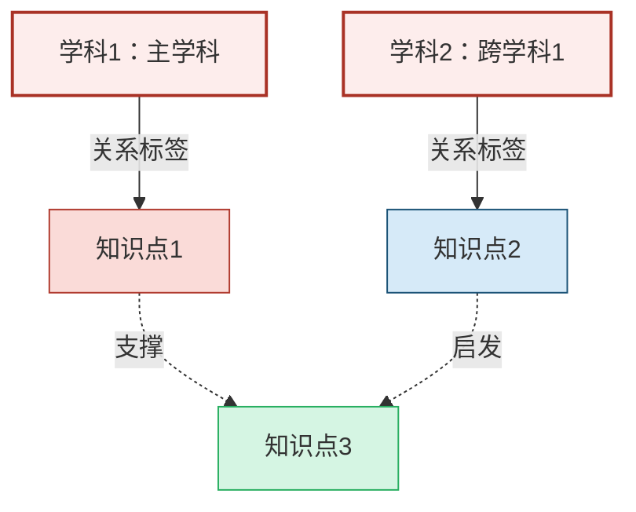

# Mermaid 跨学科知识图谱规范

阶段 1 每套方案的"跨学科具体知识详细说明"必须输出**合法、可渲染的 Mermaid 代码**（`graph TD`）。

## 结构规范

### 1. 整体布局
- 使用 `graph TD`（从上到下）。
- 每个学科作为独立中心节点，ID 为 `BI1, BI2, BI3...`，垂直排列。
- 标签格式：`"学科1：XXX"`（保留序号）。

### 2. 知识点节点
- ID 全局唯一：`K1, K2, K3...`，按出现顺序递增，**不跳号**。
- 每个知识点必须归属一个学科，并应用对应配色 class。

### 3. 连接规则
- 主干连接：`BIx -->|关系标签| Kx`，关系标签体现教学逻辑（如"科学解释""价值引导"）。
- 横向联系：不同学科下的知识点若有关联，用虚线 `-.->|标签|` 连接（标签如"基于""支撑""启发"）。

### 4. 学科配色系统（严格遵守）

| 学科 | class 名 | 填充色 | 描边色 |
|---|---|---|---|
| 学科节点（所有 BI） | `bigidea` | #FDEDEC | #A93226（2px） |
| 科学 | `science` | #D6EAF8 | #1A5276 |
| 语文 | `chinese` | #FADBD8 | #B03A2E |
| 数学 | `math` | #D5F5E3 | #27AE60 |
| 道德与法治 | `morality` | #EBDEF0 | #7D3C98 |
| 艺术（音乐/美术） | `art` | #FEF9E7 | #AF601A |
| 体育与健康 | `pe` | #E8F8F5 | #117A65 |
| 英语 | `english` | #FFF2CC | #D6B656 |
| 劳动 | `labor` | #FCF3CF | #AF601A |
| 其他（物理/化学/生物/地理/历史/信息科技等） | `other` | #F2F3F4 | #566573 |

### 5. 样式与兼容性
- 节点文字简洁，Mermaid 可自动换行。
- **必须定义所有用到的 classDef**。
- 横向连接保持默认样式，无需额外 `linkStyle`。
- 确保可在 https://mermaid.live 完美渲染。

## 交互修改支持

教师提出修改时：

1. **解析修改意图**
   - 增加节点 → 分配下一个可用 ID（已有 K1–K5，则新节点为 K6）
   - 删除节点 → 同时删除所有指向/来自该节点的连接
   - 修改连接 → 更新关系标签或目标节点
   - 调整学科节点 → 新增 BI 节点排在末尾（BI4, BI5...）
2. **继承前一版结构**：完整保留未改动部分，仅修改指定内容，避免重排 ID 或样式。
3. **逻辑校验**：
   - 若删除的节点被横向连接引用，同步删除相关边。
   - 若新增连接指向不存在的节点，先创建该节点。
4. **输出格式**：**仅输出更新后的完整 Mermaid 代码**，不要任何解释、注释、序号或额外文本。

## 常见渲染错误规避

- 节点标签含括号、引号、冒号等特殊字符时，**必须用双引号包裹整个标签**。
- 关系标签中避免使用 `|`、`{`、`}` 等符号。
- classDef 定义统一放在代码块末尾，避免与节点定义交错。
